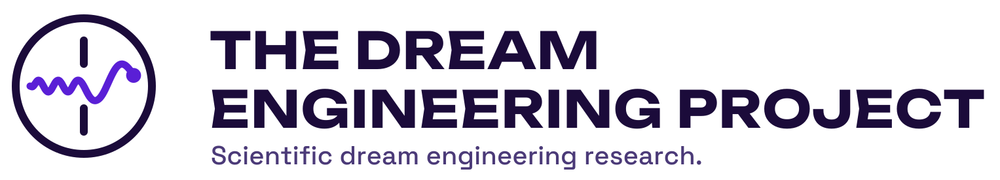
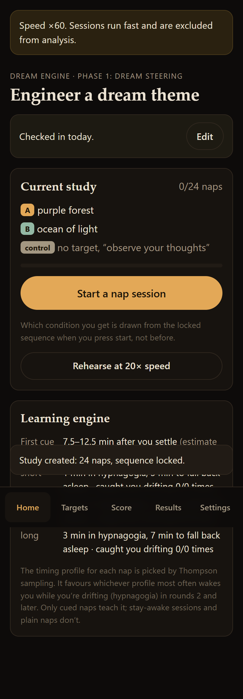
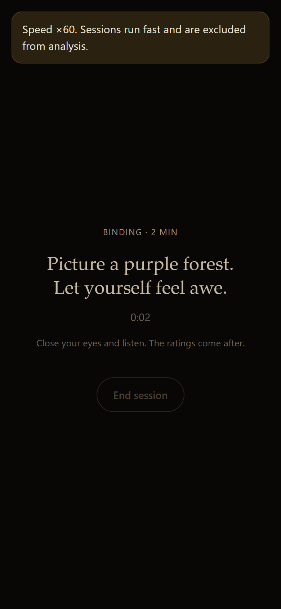
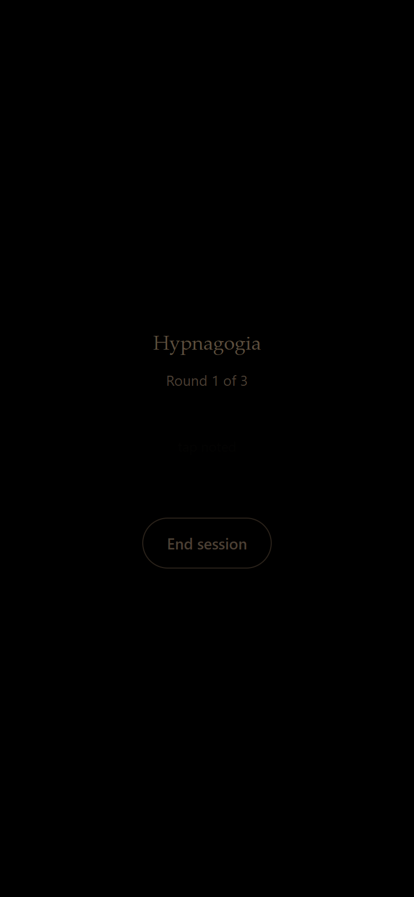
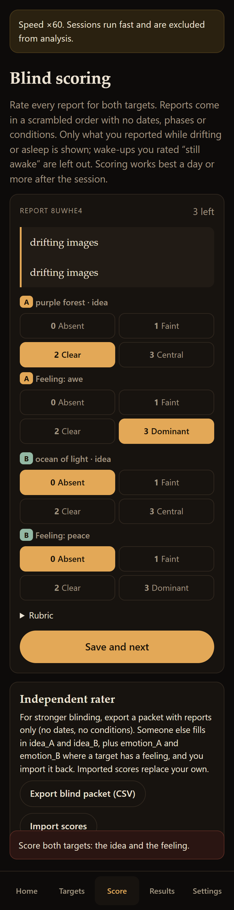
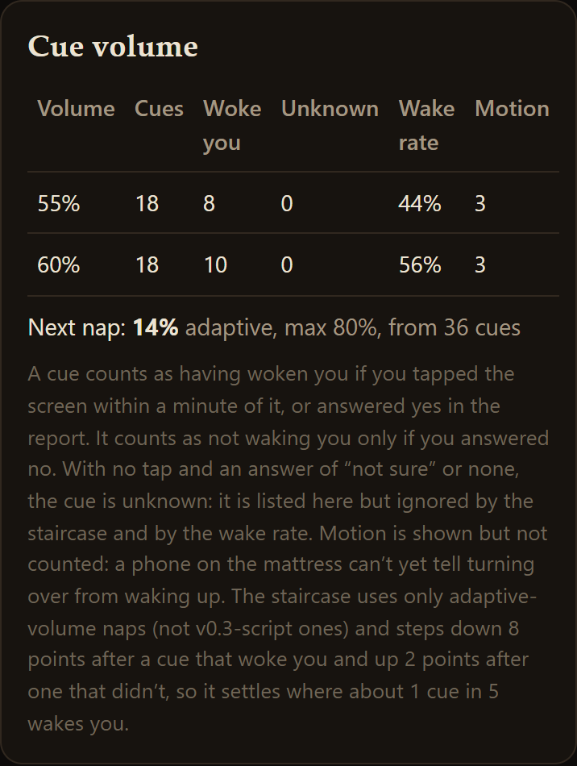
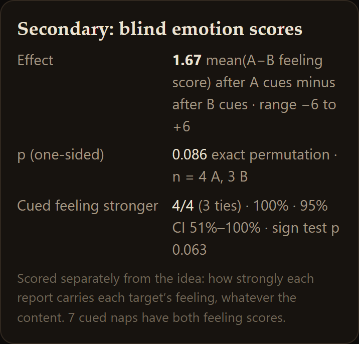
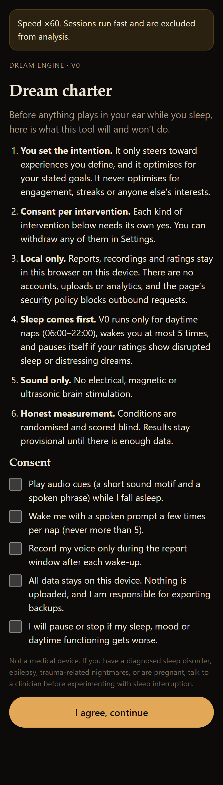
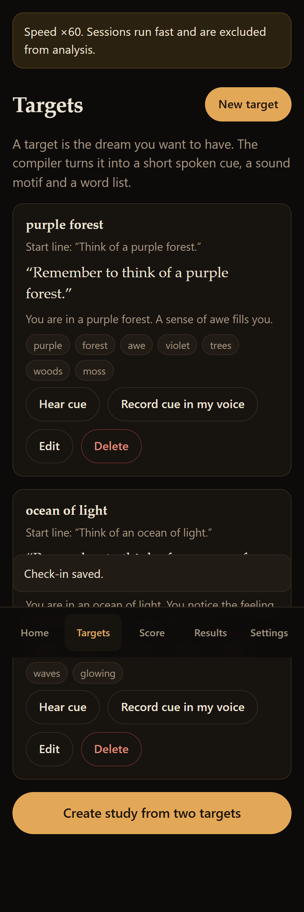

<p align="center">
  <picture>
    <source media="(prefers-color-scheme: dark)" srcset="docs/img/logo-horizontal-dark.svg">
    
  </picture>
</p>

<!-- VIDEO: launch video link goes here once the channel is live -->

# The Dream Engineering Project

### Understanding mental reality.

*Scientific dream engineering research.*

[**Read the manifesto**](MANIFESTO.md) · [The science](docs/SCIENCE.md) · [Protocol](docs/PROTOCOL.md) · [Safety](SAFETY.md) · [Contributing](CONTRIBUTING.md)

[](LICENSE)


> **Research software, not a medical device or medical advice.** Read
> [SAFETY.md](SAFETY.md) before using it. It plays sound while you fall asleep
> and wakes you a few times during a nap.

## What this is

Every night the brain runs a simulation nobody designed. **Dream engineering**
is the science of influencing the dreaming brain from the outside, with sound,
smell, touch or light, and measuring what changes. It is a real research field.

This project is an open, local-first research tool for one question:

> **Can you steer what you dream about, can you prove it did, and what does
> that do for you?**

The **Dream Engine** (this repository) is a phone-first web app that runs
Horowitz-2023-based targeted dream incubation during daytime naps, inside a
randomised, blind-scored n-of-1 study. Nothing is claimed until the data says
so. There is no real-sleep data yet.

## The science in brief

Everything here is a published finding. Full references, with authors, journal
and DOI, are in [docs/SCIENCE.md](docs/SCIENCE.md).

- **A spoken cue at sleep onset steers dreams.** Horowitz et al. (2023, *Sci
  Rep*) played "Remember to think of a tree." as people fell asleep. The tree
  appeared in **70%** of dream reports, against **1.4%** without the cue.
  Cueing awake gave about **52%**. People whose dreams took in the theme were
  more creative afterwards than people who only slept.
  [doi:10.1038/s41598-023-31361-w](https://doi.org/10.1038/s41598-023-31361-w)
- **It works at home.** A 2024 remote study (Bellaiche et al.) reported
  **91%** incorporation.
- **Voice matters.** Unfamiliar voices caused more micro-arousals in sleep than
  familiar ones (0.59 against 0.41; Ameen et al., 2022, *J Neurosci*), and
  angry voices increased arousals in non-REM sleep (Moyne et al., 2022). So the
  cue should be your own voice, calm and quiet.
- **Sleeping brains can be cued, in non-REM.** A meta-analysis found cueing
  memories in non-REM sleep works (g = 0.32) and found no effect in REM (Hu et
  al., 2020, *Psychol Bull*).
- **Two-way contact with dreamers is possible.** Konkoly et al. (2021, *Curr
  Biol*) held real-time conversations with lucid dreamers.
- **Smell is not a reliable emotion dial.** Two recent studies (2023, 2024)
  found it does not reliably set dream emotion.
- **REM is emotion-led.** In REM, emotion centres (amygdala) are up and
  executive control (dorsolateral prefrontal) is down (Maquet et al., 1996,
  *Nature*).
- **The gap.** To our knowledge, no validated consumer device yet triggers
  cues from live sleep stage at home.

## The framework: gate, emotion, meaning

We model the dreaming brain as a **generator with a gate in front of it**.
Three questions decide whether dream engineering works:

1. **Gate.** Is the brain open to input right now, and can the cue get through
   without waking you? This is the core engineering target: precision.
2. **Emotion.** The dreaming brain is emotion-led. Does the feeling of the cue
   shape the dream?
3. **Meaning.** Does the *idea* arrive, not just the sound?

> **Working hypothesis (not an established finding): emotion is compressed
> meaning.** A feeling is small enough to slip through the gate. Once inside,
> it pulls the memory it is bound to, and the idea appears.

This is testable, and it is what v0.4 is built to test: a pre-sleep step binds
each theme to a feeling, and idea and emotion are scored separately and blind.
If the hypothesis is wrong, the data should show it.

## Features (v0.4)

- **Horowitz 2023 script, in your own voice.** The published wording ("Think of
  X.", "Remember to think of X.", "And were you asleep?") is the default, and
  every line the study plays can be recorded in your own voice, line by line,
  with a checklist.
- **Pre-sleep emotion binding.** Two minutes of picturing the target while
  feeling its emotion, with the start line and cue playing, then 0 to 10
  ratings.
- **Per-cue wake tracking and a volume staircase.** Tap the screen if a cue
  wakes you, and answer "did the cue wake you?" in each report. An up-down
  staircase adjusts the cue volume from those signals (experimental: see
  Known limitations).
- **Randomised A / B / control study with blind scoring.** Blocked
  randomisation fixed when the study is created, idea and emotion scored
  separately (0 to 3), scrambled order, and an optional CSV packet for an
  independent rater. Permutation tests, with results marked provisional until
  there is enough data.
- **Phase 2: does it help beyond normal sleep?** Cued naps, stay-awake sessions
  with identical cues, and plain naps, with theme-bound word pairs and an
  Alternative Uses Task rated blind. Two pre-registered, Holm-corrected
  questions: "beyond normal sleep?" and "is it the dreaming itself?"
- **Safety built in.** Daytime naps only, caps on wake-ups, check-ins that
  pause the study automatically. See [SAFETY.md](SAFETY.md).
- **Data you own.** Trial and session tables export as CSV for your own
  analysis.

### Screenshots

Captured from the automated browser QA at phone width. **All data shown is
synthetic test data generated by the QA scripts, not a real person's.**

| Home and study | Pre-sleep binding | Night screen |
|:--:|:--:|:--:|
|  |  |  |

| Blind scoring | Cue volume | Emotion results |
|:--:|:--:|:--:|
|  |  |  |

| Charter | Targets |
|:--:|:--:|
|  |  |

## Quick start

You need [Node.js](https://nodejs.org) (developed on Node 24). There are no
runtime dependencies and no build step.

```sh
git clone <this repository>
cd <this repository>
npm install        # dev dependency only (playwright-core, for the QA)
npm run serve      # http://localhost:8787, bound to 127.0.0.1
```

Open <http://localhost:8787> in a browser on the same machine.

**On a phone.** The microphone, wake lock and offline install need a secure
context, and `localhost` counts as one. The server therefore binds to
`127.0.0.1` only, and on Android the included Windows script forwards the
phone's `localhost` to your computer over USB with `adb reverse`:

```powershell
.\start-phone.ps1   # needs Android platform-tools (adb) and USB debugging on
```

Then use Chrome's menu, **Add to Home screen**, **Install**. The app then works
offline. Use the same port every time, because the app's data is stored per
origin. Everything is untested on a real phone so far (see Status).

Then follow the on-screen steps: accept the charter, **Rehearse** while awake
to check volume and microphone, write two clearly different themes (for
example *a purple forest* and *an ocean of light*) each with a feeling,
optionally record your own voice, and create the study. The full procedure is
in [docs/PROTOCOL.md](docs/PROTOCOL.md).

## Privacy

- **Local only.** Reports, recordings and ratings stay in your browser on your
  device. There are no accounts, uploads or analytics.
- **The page cannot phone home.** The content security policy
  (`connect-src 'self'`, `default-src 'self'`) blocks outbound requests, and
  the browser QA checks for violations.
- **You hold the backups.** Export your data from Settings. Clearing site data
  or uninstalling the app deletes it.

## Status

**Verified (headless Chrome and unit tests only):**

- 71 unit tests pass (`npm test`).
- About 193 headless-Chrome end-to-end checks pass at 360 and 390 px with no
  console errors and no CSP violations (`npm run qa`). They cover the full nap
  session at 60x speed with a fake microphone, the report, the binding step,
  blind idea and emotion scoring, the rater packet round trip, results,
  exports, migration from earlier data, Phase 2, and an offline reload.

**NOT verified:**

- **No real-sleep data yet.** It has not been used during real sleep, so
  whether cues incorporate for anyone is exactly what the study is meant to
  find out. No claim is made.
- **Not tested on a phone yet.** Android Chrome speech voices, the wake lock
  with the screen off, audio over a 30-minute nap, install-to-home-screen and
  whether `devicemotion` is delivered with the screen dimmed are all untested.
- Local tests and a passing QA run are evidence that the software does what we
  wrote down, not that dream engineering works.

## Known limitations (from the v0.4 design review)

An independent review of v0.4 found issues we intend to fix in v0.5, before
any real naps count as data:

- **Blinding has gaps.** Self-typed transcripts, the sleep-state rating that
  filters reports, and a scoring queue that can be very short all leak
  information before scoring. Plan: verbatim audio transcripts, an external
  rater as the primary score, and sensitivity analyses.
- **The adaptive volume is not sound yet.** Its wake signal is mixed, the steps
  are small, and three cues per nap cannot converge. Plan: calibrate the volume
  in a run-in, then freeze it in the locked protocol.
- **Not every setting is locked.** Plan: lock all study settings, require one
  voice type, and normalise loudness.
- **It is a package, not a pure replication.** The pre-sleep emotion binding
  and the sleep-onset start line are additions to the published protocol, so
  results test the whole package.
- **The emotion-to-idea link analysis is descriptive only.**

## Safety and not medical advice

Positive themes only, check-ins that pause the study automatically, daytime
naps only, sound only. This is research software, **not a medical device, and
nothing here is medical advice.** If you have a sleep disorder, epilepsy, a
psychiatric condition, trauma-related nightmares, or are pregnant, consult a
clinician first. Full details, limits and stop rules: [SAFETY.md](SAFETY.md).

## Roadmap

- **Next:** a next-day retest for Phase 2, a content guard for target text, and
  an optional "describe your dream in plain language" layer (local model first;
  anything that sends text off the device would need explicit consent).
- **V1:** a wearable sleep-onset signal replaces the timer.
- **V2:** cueing during detected REM, with lucidity cues.
- **V3:** a predictive map built on the trial table: a state model, a response
  model, and a controller that picks cues under a hard sleep-preservation
  penalty. Expect this to need hundreds to thousands of trials.

## Contributing

Replications, including null results, are the most valuable contribution. See
[CONTRIBUTING.md](CONTRIBUTING.md) for how to run the tests and QA, why data is
never committed, and how to propose a protocol change with evidence. Please
follow the [Code of Conduct](CODE_OF_CONDUCT.md).

## Documentation

- [docs/SCIENCE.md](docs/SCIENCE.md): the research basis, with references,
  separating established findings from our hypotheses
- [docs/PROTOCOL.md](docs/PROTOCOL.md): the study, written as a
  pre-registration
- [docs/SPEC-v0.4.md](docs/SPEC-v0.4.md): the v0.4 build spec
- [CHANGELOG.md](CHANGELOG.md)

## Licence

[MIT](LICENSE), copyright The Dream Engineering Project contributors.

*Sleep well, and measure everything.*
